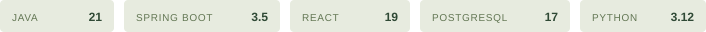
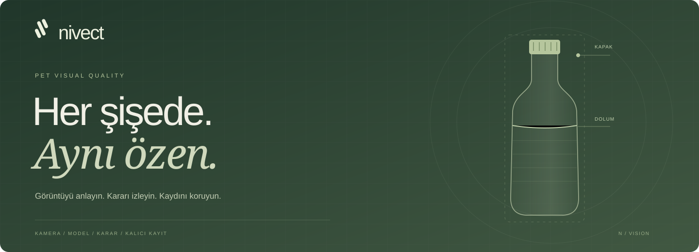
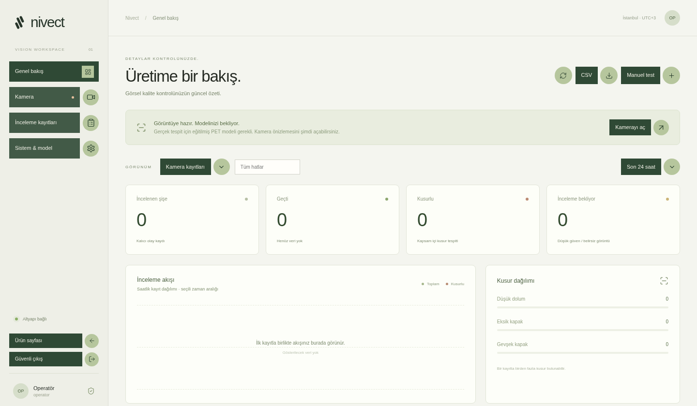
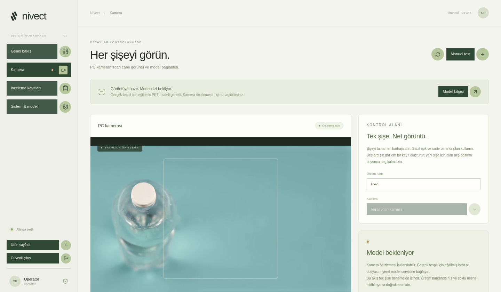
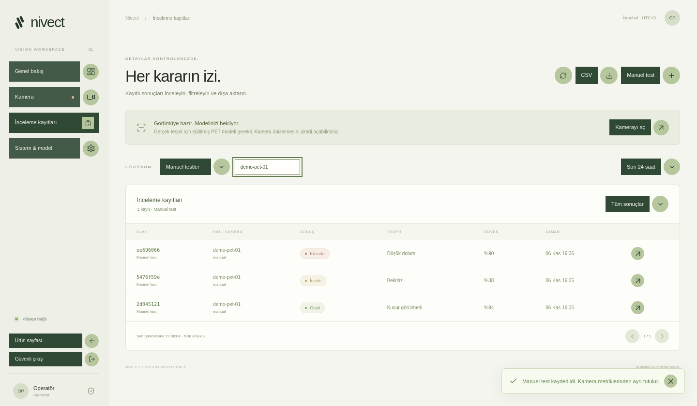
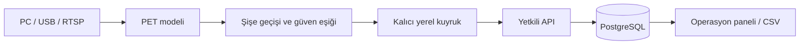

<p align="center">
  <picture>
    <source media="(prefers-color-scheme: dark)" srcset="docs/assets/nivect-logo-light.svg" />
    
  </picture>
</p>

<p align="center">
  <strong>PET şişe üretimi için görsel kalite kontrol.</strong><br />
  Görüntüyü anlayın. Kararı izleyin. Kaydını koruyun.
</p>

<p align="center">
  <a href="#ürün-turu">Ürün turu</a> ·
  <a href="#nasıl-çalışır">Nasıl çalışır?</a> ·
  <a href="#hızlı-başlangıç">Kurulum</a> ·
  <a href="docs/api.md">API</a> ·
  <a href="docs/product.md">Ürün rehberi</a>
</p>

<p align="center">
  
</p>



## Kalite, detayları görmekle başlar.

Nivect; kamera görüntüsü, PET şişe incelemesi ve kayıt yönetimini aynı çalışma
alanında buluşturan bir görsel kalite kontrol altyapısıdır. Operatör, şişenin
kararını ve geçmişini görebilir; model entegrasyonu ve belirsiz sonuçlar açık
biçimde izlenebilir.

| Gör                                               | İncele                                                            | İzini koru                                                              |
| :------------------------------------------------ | :---------------------------------------------------------------- | :---------------------------------------------------------------------- |
| PC kamerasını açın ve kontrol alanını hazırlayın. | Eğitilmiş PET modeliyle dolum ve kapak kusurlarını değerlendirin. | Sonucu kalıcı kayda dönüştürün; filtreleyin, inceleyin ve dışa aktarın. |

> [!IMPORTANT]
> **Güncel aşama:** web arayüzü, operatör oturumu, PC kamera önizlemesi, kalıcı
> kayıt ve CSV akışları kullanılabilir. Gerçek kusur tespiti için eğitilmiş
> **`best.pt` henüz gereklidir**. Ağırlık dosyası ve eğitim verisi bu depoda yoktur.
> Model hazır değilken uygulama bunu gösterir ve tespit başlatılmasını engeller.

## Ürün turu

[](docs/assets/nivect-proje-tanitimi.mp4)

**1 dakika 26 saniye · Full HD · Türkçe ekran açıklamaları.** Ana sayfa, operatör
paneli, kamera önizlemesi, manuel bağlantı testi, kayıt ayrıntıları ve CSV akışı.

[MP4 videoyu aç / indir](docs/assets/nivect-proje-tanitimi.mp4?raw=true)
· [Bölümler ve yazılı anlatım](docs/product-tour.md)
· [Türkçe altyazı](docs/assets/nivect-proje-tanitimi.tr.vtt)

Tanıtımdaki kamera görüntüsü kayıtlı PET videosudur. Gösterilen örnek kayıtlar
**MANUAL** kaynağında oluşturulur; model sonucu veya saha doğruluğu iddiası değildir.

## Çalışma alanı



| Özellik                  | Davranış                                                                         |
| :----------------------- | :------------------------------------------------------------------------------- |
| **Operasyon paneli**     | Seçili kaynak, hat ve zaman aralığı için kayıtları ve kararları görüntüler.      |
| **PC kamera önizlemesi** | Tarayıcı izniyle kamera görüntüsünü açar; model yokken tespit kapalı kalır.      |
| **PET odaklı kapsam**    | Hedef sınıflar: `bottle`, `underfill`, `missing_cap`, `loose_cap`.               |
| **İzlenebilir olaylar**  | Olay kimliği, hat, kamera, model sürümü, güven ve zaman bilgisini saklar.        |
| **Tekrarsız kayıt**      | Aynı `eventId` ile gelen aynı içerik ikinci kez kaydedilmez.                     |
| **Erişim ayrımı**        | Operatör kayıtları okuyabilir; kamera hesabı yalnızca kamera olayı gönderebilir. |
| **CSV dışa aktarım**     | Filtrelenmiş en fazla 10.000 kaydı dışa aktarır.                                 |
| **Açık durumlar**        | Bağlantı yok, model bekleniyor ve inceleme gerekli durumlarını ayrı gösterir.    |

<details>
<summary><strong>Kamera ve kayıt ekranlarını görün</strong></summary>

### PC kamera önizlemesi



Bu görselde tanıtım amacıyla kayıtlı PET görüntüsü kullanılmıştır. Modelin hazır
olmadığı durum arayüzde görünür.

### İnceleme kayıtları



Örnekler manuel bağlantı testidir. Kamera metriklerinden ayrı tutulur.

</details>

## Nasıl çalışır?

Model ağırlığı bağlandıktan sonra kullanılan görüntü–karar–kayıt akışı:



1. **Görüntüyü alın.** Kamerayı sabit ışık ve tek şişe için hazırlanmış alana yönlendirin.
2. **Modeli bağlayın.** Güvenilen yerel ağırlık dosyası sınıf sırası doğrulandıktan sonra yüklenir.
3. **Olayı oluşturun.** Beş kararlı gözlem bir olay üretir; yeni şişe için alanın beş gözlem boş kalması gerekir.
4. **Kaydı koruyun.** Tarayıcıda IndexedDB, bağımsız adaptörde SQLite outbox kullanılır.
5. **Commit sonrası onaylayın.** API, PostgreSQL işlemi tamamlanınca kaydı onaylar. Tekrar gönderim aynı olay kimliğiyle yapılır.

MQTT bağdaştırıcısı da bulunur. MQTT broker onayı, uygulamanın veritabanı commit
onayı anlamına gelmez; güvenilir üretici teslimi için dahil edilen HTTP/outbox
akışı kullanılır. Redis önceki altyapıyla uyum için korunur; yeni kayıtların
kalıcılık yolu geçici Redis List kuyruğu değildir.

### Karar sözleşmesi

| Karar      | Anlamı                                                      |
| :--------- | :---------------------------------------------------------- |
| **PASS**   | Kabul edilen güven seviyesinde, kapsam içi kusur görülmedi. |
| **FAIL**   | Kabul edilen güven seviyesinde, kapsam içi kusur bulundu.   |
| **REVIEW** | Güven yetersiz veya gönderilen inceleme olayı belirsiz.     |

Varsayılan güven eşiği `0.65` değeridir; saha verisiyle kalibre edilmelidir.
**PASS**, modelin kapsamı dışındaki kusurlar için güvence değildir. Etiket ve
yabancı madde ilk PET modelinin kabul kapsamında değildir.

## Hızlı başlangıç

**Gereksinimler:** Docker Compose · Java 21 JDK · Maven 3.9+ · Node 22+ · Python 3.12+

Depo kökünde:

```bash
./scripts/setup-dev.sh
./scripts/build.sh
python3 -m venv .venv
.venv/bin/pip install -r camera/requirements.lock
./scripts/dev.sh
```

Uygulama ve API **8080** portunda birlikte sunulur. Giriş kullanıcısı `operator`;
parolası yalnızca Git'in yok saydığı yerel `.env` dosyasındaki
`QC_OPERATOR_PASSWORD` değeridir. Kamera adaptörü için ayrı `QC_INGEST_PASSWORD`
kullanılır. Mevcut 8080/9000 süreçleri varsa ikinci bir servis başlatmayın.

`setup-dev.sh` mevcut değerleri korur; `dev.sh` durdurulduğunda veri volume'lerini
silmez. Windows kurulumu, Docker kullanımı, geliştirme sunucusu ve ayrıntılı
başlangıç adımları [geliştirici rehberinde](docs/getting-started.md).

### Eğitilmiş modeli bağlama

```bash
.venv/bin/pip install -r camera/requirements-model.txt
QC_MODEL_PATH=/absolute/path/best.pt \
  .venv/bin/uvicorn camera.server:app --host 127.0.0.1 --port 9000
```

Önce mevcut model servisini durdurun. `QC_MODEL_PATH` başlangıçta okunur.
PC kamera önizlemesi için **HTTPS veya localhost** ve tarayıcı izni gerekir.
Bağımsız kamera adaptörü, veri hazırlığı ve eğitim adımları için
[ürün rehberini](docs/product.md) ve [geliştirici rehberini](docs/getting-started.md)
izleyin. Güvenilmeyen `.pt` dosyalarını yüklemeyin.

## Proje haritası

```text
frontend/             Güncel Nivect arayüzü ve ortak kontrol tasarımı
src/main/             Spring Boot API, güvenlik, kayıt ve veritabanı geçişleri
camera/               PC kamera adaptörü, yerel model servisi ve outbox
training/             Veri ayrımı denetimi ve eğitim girişi
scripts/              Kurulum, başlatma, yedekleme ve doğrulama
legacy/frontend/      Korunan önceki VisionQC demo uygulaması
```

## Doğrulama ve üretime geçiş

```bash
mvn -B -ntp verify
npm --prefix frontend test
python3 -m unittest discover -s tests -v
python3 scripts/test-product.py
cd frontend && npm run test:e2e
```

Entegrasyon ve tarayıcı kontrolleri çalışan yerel servisler gerektirir. Tarayıcı
kamera testleri simüle edilmiş kaynakla yapılır. Kontrol sonuçları ve kapsamı
[doğrulama kaydında](docs/validation.md) tutulur.

Gerçek üretime geçiş; fiziksel kamera doğrulaması, bağımsız saha verisiyle model
değerlendirmesi, eşik kalibrasyonu, TLS/erişim politikaları ve yedek–geri yükleme
tatbikatı gerektirir. İlk akış tek şişe denemeleri içindir; çoklu nesne takibi,
hat hızı ve PLC/ayırıcı donanım kabulü tamamlanmış sayılmaz.

## Dokümantasyon

| Rehber                                              | İçerik                                            |
| :-------------------------------------------------- | :------------------------------------------------ |
| [Başlangıç](docs/getting-started.md)                | Yerel kurulum, Docker, kamera ve test komutları   |
| [Ürün](docs/product.md)                             | Model, veri, kalıcılık ve üretime geçiş sınırları |
| [API](docs/api.md)                                  | Oturum, CSRF, inceleme sözleşmesi ve endpoint'ler |
| [Tasarım sistemi](docs/controls.md)                 | Logo ile uyumlu kontrol renkleri ve hareketleri   |
| [Ürün turu](docs/product-tour.md)                   | Video bölümleri, yazılı anlatım ve demo kapsamı   |
| [Doğrulama](docs/validation.md)                     | Gerçekte çalıştırılan kontroller ve kalan işler   |
| [Dal birleştirme](docs/branch-integration.md)       | Güncel ve tarihsel frontend'in ayrımı             |
| [Araştırma not defteri](visionqc_ron88_train.ipynb) | Önceki eğitim ve değerlendirme çalışması          |

Önceki not defterindeki aynı çekim ortamına ait metrikler, yeni bir üretim hattında
başarı kanıtı değildir. Eğitim verisi ve model ağırlıkları depoda bulunmaz.

---

<p align="center">
  <br />
  <sub><strong>NIVECT</strong> · Görsel zekâ. Gerçek özen.</sub>
</p>
