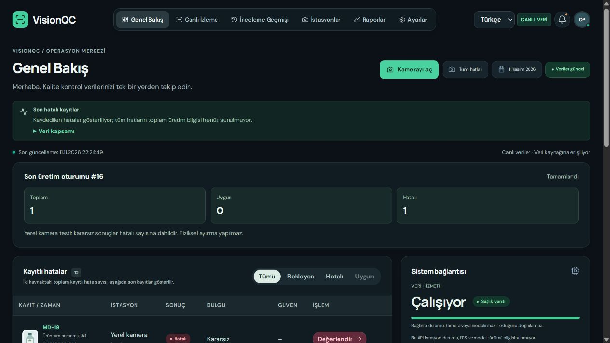
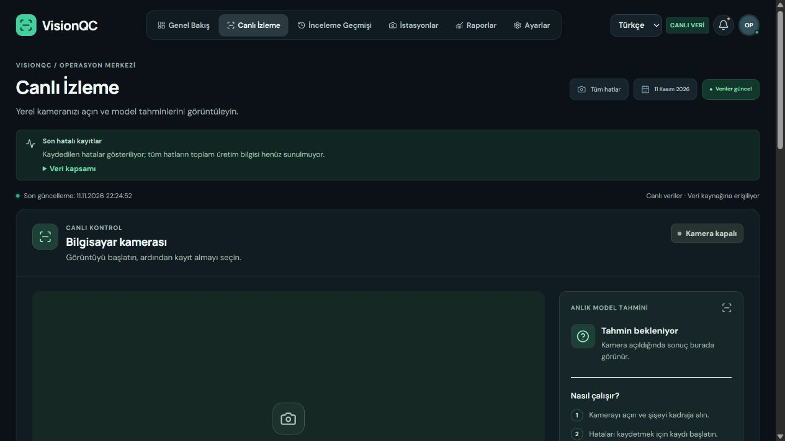

# VisionQC

**PET şişeler için kamera destekli kalite kontrol paneli**

VisionQC, yerel kameradan alınan görüntüleri modelle değerlendirir; operatörün sonuçları, üretim oturumu sayaçlarını ve hatalı ürün kayıtlarını tek panelden izlemesini sağlar.

[Uygulama ekranları](#uygulama-ekranları) · [Nasıl çalışır?](#nasıl-çalışır) · [Kurulum](#kurulum) · [Proje yapısı](#proje-yapısı)

## Uygulama ekranları

### Genel bakış

Son üretim oturumunun toplam, uygun ve hatalı ürün sayılarını; kayıtları ve sistem bağlantısını görüntüleyin.



### Canlı izleme

Kamerayı açın, model tahminlerini izleyin ve istediğinizde kayıt oturumunu başlatın. Görsel kamera kapalıyken alınmıştır.



## Nasıl çalışır?

1. Panelden bilgisayar kamerasını açın ve kayıt oturumunu başlatın.
2. Model, görüntüdeki şişeyi ve desteklenen kusurları değerlendirir.
3. Şişe kadrajdan çıktığında oturum sayaçları güncellenir. Uygun ürünler sayılır; hatalı ve kararsız sonuçlar ayrıntılı kayıt olarak tutulur.
4. Kaydedilen sonuçları panelde inceleyin ve değerlendirin.

Bu akış tek şişeli yerel kamera denemesi içindir. Kesin bant sayımı veya fiziksel ürün ayırma yapmaz. Modelin desteklediği kusurlar eksik kapak, gevşek kapak ve düşük dolumdur.

## Kurulum

### Gereksinimler

- Windows ve çalışır durumdaki Docker Desktop
- Python 3.12 ve model için bir Python sanal ortamı
- Ekipten temin edilecek uyumlu `best.pt` model dosyası
- Bilgisayara bağlı kamera ve tarayıcı kamera izni

### 1. Servisleri başlatın

Projenin ana klasöründe PowerShell veya IntelliJ terminalinden çalıştırın:

```powershell
powershell -ExecutionPolicy Bypass -File ./scripts/visionqc.ps1
```

İlk çalıştırmada yerel parolaları içeren `.env` dosyası oluşturulur. Docker, panel ve backend ile birlikte PostgreSQL, Redis ve Mosquitto servislerini başlatır. Paneli [localhost:5197](http://localhost:5197) adresinden açın.

### 2. Model ortamını hazırlayın

İlk kurulumda proje klasöründe bir sanal ortam oluşturun ve bağımlılıkları yükleyin:

```powershell
py -3.12 -m venv .venv
.\.venv\Scripts\python.exe -m pip install -r camera/requirements.txt
```

GPU kullanımı CUDA destekli PyTorch kurulumuna bağlıdır. Model ağırlıkları ve ortam dosyaları Git deposuna eklenmez.

### 3. Model servisini başlatın

Ayrı bir terminalde aşağıdaki örneği kullanın; dosya yollarını kendi bilgisayarınıza göre değiştirin:

```powershell
powershell -ExecutionPolicy Bypass -File ./camera/start.ps1 -Weights "C:\model\best.pt" -Python "C:\model\venv\Scripts\python.exe"
```

Kamera ve model hakkında ayrıntılar: [Yerel kamera rehberi](camera/README.md).

### Servisleri kontrol etme ve durdurma

```powershell
powershell -ExecutionPolicy Bypass -File ./scripts/visionqc.ps1 -Action status
powershell -ExecutionPolicy Bypass -File ./scripts/visionqc.ps1 -Action stop
```

`stop` kayıtları silmez. Kurulum ayrı `visionqc-local` Docker veri alanlarını kullanır ve önceki `nivect-dev` kayıtlarını otomatik taşımaz. Portlar kullanımda ise önce çakışmayı giderin.

## Proje yapısı

| Yol | İçerik |
| --- | --- |
| `frontend/` | VisionQC kullanıcı arayüzü |
| `src/` | Spring Boot backend |
| `camera/` | Yerel model servisi ve kamera rehberi |
| `scripts/` | Kurulum ve kontrol komutları |
| `training/` | Model eğitimi kodları |
| `compose.yaml` | Yerel Docker servisleri |

Bu sürüm yerel test içindir ve kullanıcı girişi sağlamaz. Ortak ağa veya internete açmadan önce kimlik doğrulama ve güvenlik ayrıca geliştirilmelidir.
