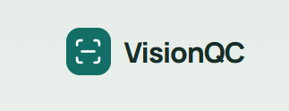
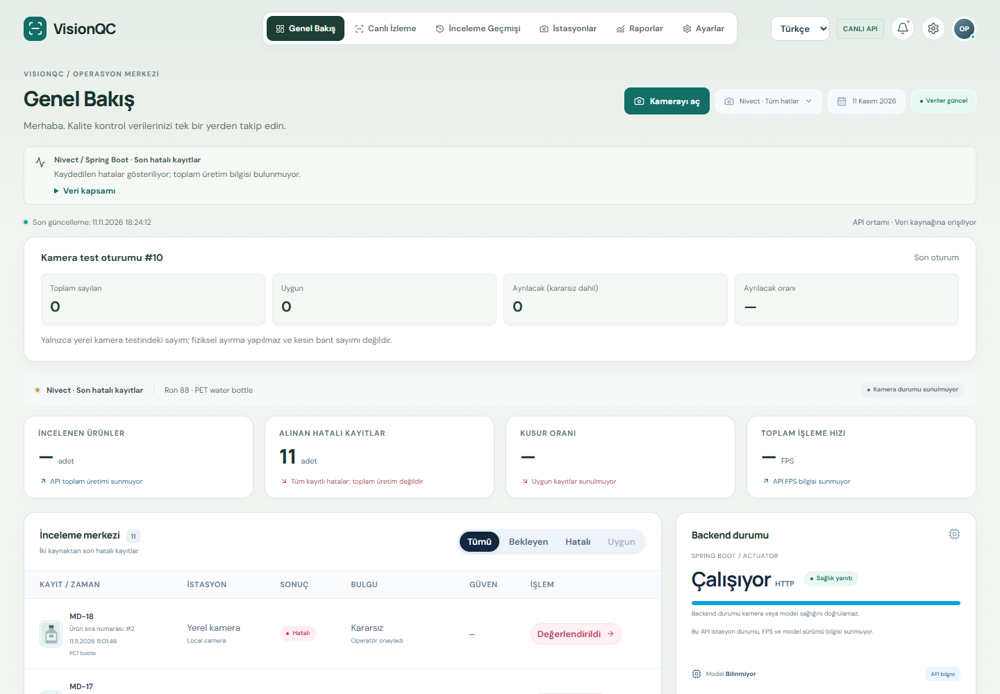
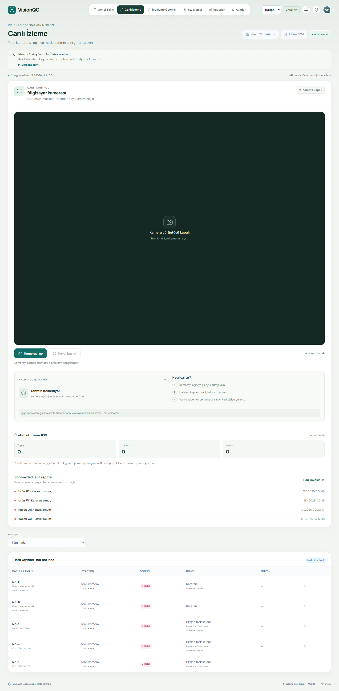
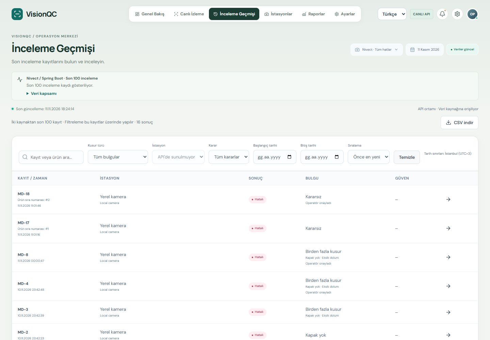

<p align="center">
  
</p>

# VisionQC

**PET şişe üretim hatları için kamera tabanlı kalite kontrol.**

VisionQC, operatörün PET şişeleri kamera ile incelemesini, kapak ve dolum
kusurlarına ilişkin kararları izlemesini ve inceleme kayıtlarını dışa aktarmasını
sağlar. İlk kapsam, kontrol alanından tek tek geçen şişelerde düşük dolum,
eksik kapak ve gevşek kapak tespitidir.

[Uygulama ekranları](#uygulama-ekranları) ·
[İnceleme akışı](#inceleme-akışı) ·
[Kurulum](#kurulum) ·
[API](docs/api.md)

## Uygulama ekranları

Görseller, VisionQC’nin yerelde çalışan ve API’ye bağlı arayüzünden alınmıştır.

### Genel Bakış



Operatör son kamera test oturumundaki toplam, uygun ve ayrılacak şişe
sayılarını görebilir.

### Canlı İzleme



Kamera ve kayıt ayrı kontrollerle başlatılır. Ekran görüntüsü kamera kapalıyken
alınmıştır.

### İnceleme Geçmişi



Operatör API’den gelen kayıtları filtreleyebilir ve CSV olarak indirebilir.

## İnceleme akışı

1. **Görüntüyü al.** Operatör panelinden PC kamerası açılır. Bağımsız kamera
   adaptörü USB kamera, video dosyası veya RTSP akışıyla çalışabilir.
2. **Şişeyi değerlendir.** Yerel model, kontrol alanındaki şişeyi inceler.
   Kararlı gözlemler aynı şişe geçişi için tek bir olay oluşturur.
3. **Kararı kaydet.** Olay, hat ve kamera bilgisi, zaman, güven skoru ve model
   sürümüyle PostgreSQL'e kaydedilir. Yeniden gönderimlerde aynı olay kimliği
   kullanılır.
4. **Sonucu incele.** Operatör panelde kararları takip eder ve filtreli kayıtları
   dışa aktarır.

| Karar | Anlamı |
| --- | --- |
| `PASS` | Model yeterli güvenle kapsam içi kusur görmedi. |
| `FAIL` | Model yeterli güvenle kapsam içi kusur tespit etti. |
| `REVIEW` | Sonuç operatör incelemesi gerektiriyor. |

### Projenin durumu

Operatör girişi, kamera önizlemesi, inceleme kaydı ve CSV dışa aktarımı
uygulamada mevcut. Güncel tespit modeli, 10 Kasım 2026 tarihli YOLO11m
eğitiminden alınmıştır. Ağırlık dosyası ve eğitim verisi depo dışında tutulur.
Dosyayı doğrulamak ve modeli bağlamak için [model kurulumuna](docs/getting-started.md#pc-kamerası-ve-gerçek-tespit) bakın.

Üretim hattında kullanım için fiziksel kamera, hat hızı ve karar eşiklerinin
saha verisiyle doğrulanması gerekir. Otomatik fiziksel ayırma ilk kapsamın dışındadır.

## Kurulum

**Gereksinimler** · Docker Compose, Java 21 JDK, Maven 3.9+, Node.js 22+ ve Python 3.12+.

Depo kökünde, Bash ile:

```bash
./scripts/setup-dev.sh
./scripts/build.sh
python3 -m venv .venv
.venv/bin/pip install -r camera/requirements.lock
./scripts/dev.sh
```

Uygulama `http://localhost:8080` adresinde açılır. Kullanıcı adı `operator`,
parola yerel `.env` dosyasındaki `QC_OPERATOR_PASSWORD` değeridir.

Windows ve Docker adımları, kamera izni ve model servisi yapılandırması için
[geliştirici başlangıç rehberine](docs/getting-started.md) bakın.

## Depo yapısı

| Dizin | İçerik |
| --- | --- |
| `frontend/` | React operatör arayüzü |
| `src/main/` | Spring Boot API, erişim kontrolü ve PostgreSQL geçişleri |
| `camera/` | Kamera adaptörü, yerel model servisi ve gönderim kuyruğu |
| `training/` | Veri ayrımı denetimi ve model eğitim araçları |
| `scripts/` | Kurulum, başlatma ve doğrulama komutları |

[Ürün rehberi](docs/product.md) · [API sözleşmesi](docs/api.md) ·
[Doğrulama kaydı](docs/validation.md)
