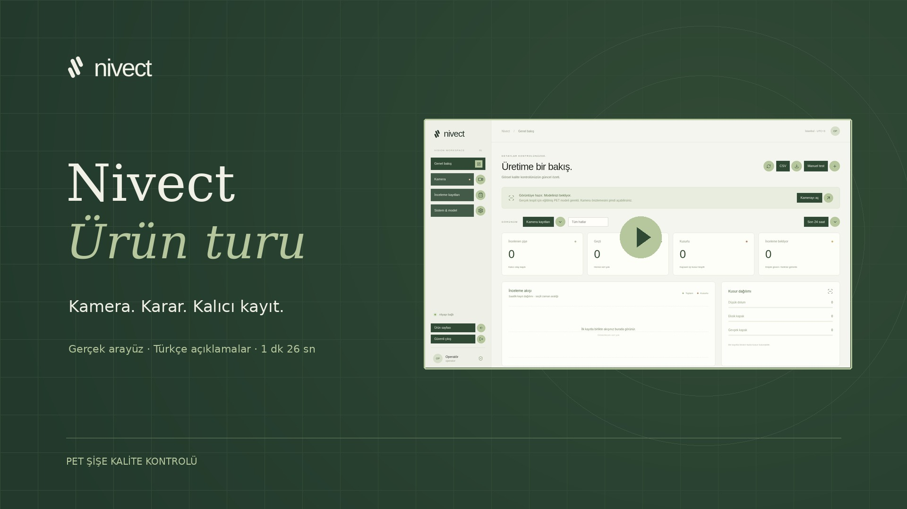

# Nivect ürün turu

[MP4 videoyu aç / indir](assets/nivect-proje-tanitimi.mp4?raw=true) ·
[Türkçe altyazı dosyası](assets/nivect-proje-tanitimi.tr.vtt) ·
[README'ye dön](../README.md)

**Süre:** 1 dakika 26 saniye. **Biçim:** 1920 × 1080, H.264 / AAC.
Video, çalışan Nivect arayüzünün kaydını; markaya uygun giriş, bölüm açıklamaları
ve animasyonlu çalışma akışıyla birleştirir. Anlatım Türkçe ekran metinleriyle
yapılır. Ayrıca seçilebilir Türkçe altyazı ve bölüm işaretleri içerir.
Arka plan sesi yerel olarak sentezlenmiştir; konuşma seslendirmesi yoktur.

## Bölümler ve yazılı anlatım

| Zaman     | Ekran                 | Anlatılan işlem                                                                  |
| :-------- | :-------------------- | :------------------------------------------------------------------------------- |
| **00:00** | Nivect                | PET şişe kalite kontrolü için ürünün kapsamı.                                    |
| **00:06** | Ana sayfa             | Ürünü tanıyın; hareketli üretim görüntülerini ve ortak kontrol tasarımını görün. |
| **00:18** | Operatör girişi       | Yetkili operatör hesabıyla çalışma alanına girin.                                |
| **00:23** | Genel bakış           | Kaynak, hat ve zaman aralığına göre kayıtları ve kararları izleyin.              |
| **00:31** | Kamera                | PC kamera önizlemesini açın. Model beklenirken tespit başlatılamadığını görün.   |
| **00:41** | Manuel bağlantı testi | Düşük dolum seçerek test gönderin; kayıt tamamlandığında API onayını alın.       |
| **00:49** | İnceleme kayıtları    | MANUAL kaynağını ve hat filtresini seçin; ayrıntı açın ve CSV indirin.           |
| **00:59** | Sistem ve model       | Mevcut bağlantıları ve model ağırlığının beklendiği durumu inceleyin.            |
| **01:07** | Çalışma akışı         | Model bağlandığında görüntü → PET modeli → karar → kalıcı kayıt akışını izleyin. |
| **01:19** | Sonraki adımlar       | Veriyi hazırlayın, modeli eğitin ve kendi kamera koşullarınızda doğrulayın.      |

## Gösterimin kapsamı

Kayıt, yerel Docker uygulamasında gerçek oturum, form, API, PostgreSQL ve CSV
akışları kullanılarak alınmıştır. Tarayıcının kamera girişine tanıtım için
[mevcut PET sunum klibi](../frontend/public/media/single-bottle.mp4) verilmiştir;
fiziksel PC kamerasında yapılmış bir saha testi değildir. Görüntü, eğitilmiş
modele gönderilmemiştir.

Üç örnek **MANUAL** kaydı PASS, FAIL ve REVIEW kararlarını göstermek için
oluşturulmuştur. Kamera metriklerine dahil edilmezler. Kayıt sonrasında yalnızca
bu üç olay kimliğine ait geçici veriler temizlenmiştir; videodaki örneklerin
çalışan veritabanında kalması beklenmez.

**`best.pt` bu depoda yoktur.** Videodaki animasyon çalışma akışını açıklar;
gerçek model çıkarımı veya doğruluk ölçümü değildir. Canlı tespit için model
ağırlığını yükleyin ve kendi şişe, kamera ve aydınlatma koşullarınızda doğrulayın.
Kurulum adımları [başlangıç rehberindedir](getting-started.md).

## Medya ve marka

Kapak, logo varyantları, poster ve açıklama kartları uygulamanın yeşil, adaçayı
ve krem paletini kullanır. Tarayıcı kaydının üzerindeki açıklamalar uygulama
arayüzünün parçası değildir. Sunum kliplerinin kaynakları ve düzenlemeleri
[medya notunda](media.md) kayıtlıdır.
